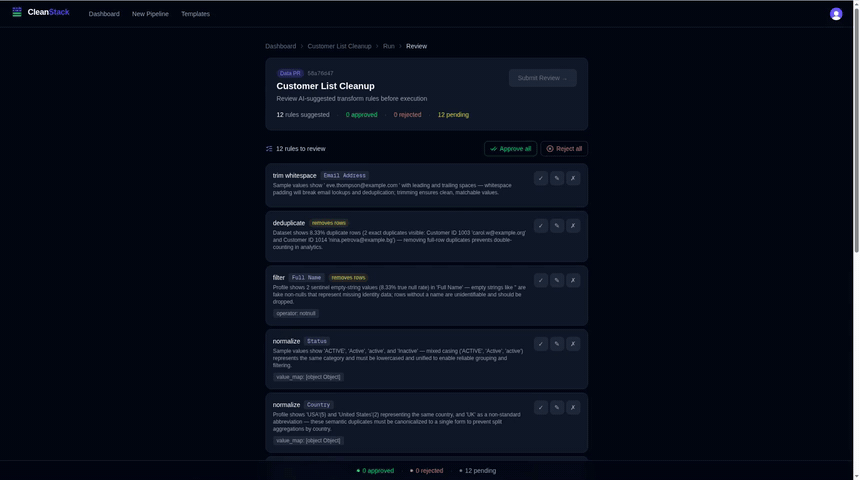

# CleanStack

CleanStack cleans tabular files and documents with AI suggestions and human approval. A Lambda profiles each upload. Claude on Amazon Bedrock then proposes transform rules, each with a reason, and you approve or reject them in a "Data PR". A second Lambda applies the approved rules with pandas and returns the cleaned file with a before/after quality score.

> **The hosted demo has been retired.** The former Vercel deployment and its AWS backend have been shut down, so there is no live instance. The recording below shows the app as it ran. To try CleanStack, self-host it with the steps in [Self-hosting / Setup](#self-hosting--setup).

**Demo:** [full 103-second walkthrough (MP4, 3.6 MB)](docs/demo.mp4)



## Features

- **Upload and profile:** CSV, TSV, TXT, JSON, JSONL, XLSX, XLS (delivered as XLSX), XML, PDF and DOCX. Each file gets per-column statistics and a quality score.
- **AI-suggested rules, human-approved:** Claude proposes rules from a fixed set that the executor implements ([rule reference](docs/transform-rules.md)). You review them in a Data PR. Unsafe rules are skipped with a reason instead of half-applied.
- **Auto-clean:** a committee of three Claude reviewers votes on each rule. Higher-risk rules need more votes. Runs that are over the AI budget fall back to manual review.
- **Multi-pass:** up to 3 passes per run. Each pass is re-scored on the bytes that were actually written.
- **Outputs:** download in the original format, **Export As** another format, or export training JSONL (raw, Alpaca or chat). Original values go to a separate `audit.csv` and are never added to the deliverable.
- **Pipelines and templates:** save the approved rules of a pipeline as a template and reuse it. A chat builder can draft pipelines and synthetic data.
- **Schema drift alerts:** optional Slack webhook per pipeline.
- **Usage controls:** monthly row quotas per plan (Free: 50,000 rows; plans are assigned by an admin, with no payment integration), Upstash rate limits, and an AI spend cap checked in Postgres before every Bedrock call.
- **Guest access:** **Try as guest** on the landing and sign-in pages starts a 24-hour session with no account. **Try with sample data** loads a seeded demo template, so it makes no Bedrock call. Guests get 2 MB files, 3 uploads, 5,000 rows per run and 10 AI calls per hour, with $0.25 of AI spend per guest. AI-heavy or irreversible features (chat builder, auto-clean, training export, Slack alerts, templates, account deletion) are blocked for guests. A guest's data is erased by the purge that runs every 4 hours, once the 24-hour session has ended. [Full limits](docs/security-model.md#guest-access)

## Architecture

```
Browser ── Next.js 16 (Clerk auth, API routes) ── Aurora PostgreSQL (RDS Data API)
   │ presigned POST (size-capped)            presigned GET (downloads) ◄── S3 processed bucket
   ▼
S3 raw bucket ── S3 event ──► Lambda profiler ──► webhook ──► suggest-transforms (Bedrock Claude)
                                             (inline, or SQS AI jobs queue ► Lambda ai-trigger)
Data PR approval / auto-clean ──► SQS executor queue ──► Lambda executor ──► S3 processed bucket
                                                         └─ schema changed ► SNS ► Lambda drift ► Slack
```

| Part | Code | Runs on |
|---|---|---|
| Web app and API | `src/` (App Router) | Any Next.js host (formerly Vercel) |
| Profiler | `lambdas/profiler/handler.py` | Lambda, S3 trigger on the raw bucket |
| AI trigger | `lambdas/ai-trigger/handler.py` | Lambda, SQS AI jobs queue; calls `/api/suggest-transforms` |
| Executor | `lambdas/executor/handler.py` | Lambda, SQS executor queue |
| Drift | `lambdas/drift/handler.py` | Lambda, SNS |
| Schema | `src/lib/schema.sql`, `src/lib/migrations/00N_*.sql` | Aurora PostgreSQL |

Other services: Clerk (auth), Upstash Redis (rate limits and quota cache, which fail open when not configured) and Sentry (optional). AWS resources are configured by hand, and there is no infrastructure as code in this repo.

A run moves through `pending → profiling → awaiting_ai → awaiting_approval → queued → running → completed | failed`. Execution is idempotent per run: the executor claims a run with a conditional `UPDATE`, so a duplicate SQS delivery is skipped. A run stuck for 20 minutes is marked failed by `/api/cron/reconcile-runs`, which runs every 4 hours.

## Self-hosting / Setup

Everything below comes from the code in this repo. AWS resources are created by hand (there is no infrastructure as code); [docs/deployment.md](docs/deployment.md) has the full detail for each step.

### Prerequisites

- Node.js 20 or 22, and Python 3.12 (Lambdas and their tests).
- Docker, only for the integration/e2e test services.
- An AWS account with: Aurora PostgreSQL Serverless v2 with the RDS Data API enabled and a Secrets Manager secret for its credentials, two S3 buckets (raw and processed), SQS, SNS, Lambda, EventBridge, and Amazon Bedrock access to Claude Sonnet 4.6 (`us.anthropic.claude-sonnet-4-6`, set in `src/lib/ai-config.ts`).
- A Clerk application (auth, required).
- Optional: Upstash Redis (rate limits and quota cache), Sentry (error reporting), Cloudflare Turnstile (guest sign-up).

There is no local mock stack: the running app talks to real Aurora, S3, SQS, Bedrock and Clerk.

### 1. Install and configure

```bash
npm ci
cp .env.example .env.local     # then fill in real values
```

`src/lib/env.ts` is the full contract, and `.env.example` lists every variable (a test enforces this). At startup the server logs any variable that is missing or invalid.

| Variable | Required | Description |
|---|---|---|
| `AWS_REGION` | No | Region for S3, SQS, RDS Data API and Bedrock (default `us-east-1`) |
| `AURORA_CLUSTER_ARN` | Yes | Aurora Serverless v2 cluster ARN (RDS Data API) |
| `AURORA_SECRET_ARN` | Yes | Secrets Manager ARN with the database credentials |
| `S3_RAW_BUCKET` | Yes | Bucket that receives uploads and triggers the profiler |
| `S3_PROCESSED_BUCKET` | Yes | Bucket the executor writes cleaned files to |
| `SQS_QUEUE_URL` | Yes | Executor queue; without it approved runs complete without executing |
| `AI_QUEUE_ENABLED` | No | `true` to enqueue AI suggestion jobs instead of calling suggest-transforms inline |
| `AI_JOBS_QUEUE_URL` | When `AI_QUEUE_ENABLED=true` | AI jobs queue consumed by the ai-trigger Lambda |
| `NEXT_PUBLIC_APP_URL` | Yes | Public base URL of the app, used for internal webhook calls |
| `WEBHOOK_SECRET` | Yes | Shared secret between the Lambdas and the webhook routes (≥ 32 chars, `openssl rand -hex 32`) |
| `CRON_SECRET` | Yes | Bearer secret for `/api/cron/*` (≥ 32 chars) |
| `NEXT_PUBLIC_CLERK_PUBLISHABLE_KEY`, `CLERK_SECRET_KEY` | Yes | Clerk keys |
| `ADMIN_SECRET` | No | `x-admin-secret` for `/api/admin/*`; admin routes are disabled when unset (≥ 32 chars) |
| `ADMIN_EMAILS`, `ADMIN_USER_IDS` | No | Comma-separated emails / Clerk user ids treated as admins (billing bypass) |
| `UPSTASH_REDIS_REST_URL`, `UPSTASH_REDIS_REST_TOKEN` | No | Rate limiting and quota cache; both are off when unset |
| `GUEST_COOKIE_SECRET` | No | Signs guest session cookies; guest access is off when unset or shorter than 32 chars |
| `TURNSTILE_SECRET_KEY`, `NEXT_PUBLIC_TURNSTILE_SITE_KEY` | No | Cloudflare Turnstile on "Try as guest" (set both or neither) |
| `MAX_UPLOAD_MB` | No | Per-file upload limit for signed-in users (default 100; guests are fixed at 2). Keep equal on the profiler Lambda |
| `LOG_LEVEL` | No | `debug`, `info`, `warn` or `error` (default `info`) |
| `SENTRY_DSN`, `NEXT_PUBLIC_SENTRY_DSN` | No | Server/edge and browser Sentry DSNs |

AWS credentials are read by the AWS SDK from its standard sources (for example `AWS_ACCESS_KEY_ID` / `AWS_SECRET_ACCESS_KEY`); the permissions needed are listed under [IAM](docs/deployment.md#iam). `CLEANSTACK_TEST_MODE`, `DB_DRIVER` and `DATABASE_URL` are for the test suites only, and the `AURORA_HOST`/`AURORA_PORT`/`AURORA_USER`/`AURORA_DB`/`RDS_CA_BUNDLE` block is read only by the migration runner.

### 2. Create the database schema

```bash
AURORA_HOST=<cluster endpoint> RDS_CA_BUNDLE=/path/to/global-bundle.pem \
  node src/lib/migrations/run-migration.mjs
```

`run-migration.mjs` applies `src/lib/schema.sql` and then `src/lib/migrations/001_indexes.sql`, `002_ai_usage_tables.sql` and `003_guest_sessions.sql` in order. Every statement is idempotent. It connects with RDS IAM auth (`AURORA_USER` default `postgres`, `AURORA_DB` default `cleanstack`), or with `DATABASE_URL` for a plain Postgres; `MIGRATIONS_ONLY=1` skips `schema.sql`. Without IAM auth you can apply the files through the RDS Data API from CloudShell ([Option B](docs/deployment.md#database-migrations)). Starter templates are in `src/lib/seed-templates.sql`.

### 3. Run the web app

```bash
npm run dev                    # http://localhost:3000
npm run build && npm start     # production build
```

### 4. Deploy the AWS backend

1. **S3:** a raw and a processed bucket. Raw bucket CORS allows `PUT`, `GET` and `POST` from the app origin; processed bucket CORS allows `GET`. Optionally add a lifecycle rule that expires the `guest_` prefix after 1 day.
2. **SQS:** an executor queue (visibility timeout ≥ the executor's timeout, with a dead-letter queue) and, if you set `AI_QUEUE_ENABLED=true`, an AI jobs queue.
3. **SNS:** a drift topic.
4. **Lambdas** (Python 3.12, `handler.handler`), each packaged as its `handler.py` plus its pinned `requirements.txt`. The profiler and executor also need the `AWSSDKPandas-Python312` layer, which provides pandas and numpy. ai-trigger uses only the standard library.

   | Function | Code | Trigger | Environment |
   |---|---|---|---|
   | profiler | `lambdas/profiler/` | Raw bucket event notification on **all object create events** (`s3:ObjectCreated:*`) | `DATABASE_URL` (IAM token auth), `APP_URL`, `WEBHOOK_SECRET`, `MAX_UPLOAD_MB`, `SENTRY_DSN`, `AWS_REGION` |
   | ai-trigger | `lambdas/ai-trigger/` | AI jobs queue; POSTs to `$APP_URL/api/suggest-transforms` | `APP_URL`, `WEBHOOK_SECRET` |
   | executor | `lambdas/executor/` | Executor queue (`BatchSize: 1`) | `DB_SECRET_ARN`, `S3_RAW_BUCKET`, `S3_PROCESSED_BUCKET`, `SNS_DRIFT_TOPIC_ARN`, `SENTRY_DSN`, `AWS_REGION`; tuning: `EXECUTOR_MAX_ATTEMPTS`, `SEMANTIC_DEDUP_MAX_ROWS`, `SEMANTIC_DEDUP_BUDGET_S`, `EXECUTOR_RESERVE_S` |
   | drift | `lambdas/drift/` | Drift SNS topic; posts to a pipeline's Slack webhook | `DB_SECRET_ARN`, `AWS_REGION` |

   The profiler, ai-trigger and web app must share the same `WEBHOOK_SECRET`, and `APP_URL` must be the app's public URL so the Lambdas can reach its webhook routes. `SENTRY_DSN` is optional everywhere.
5. **Schedules:** `GET /api/cron/reconcile-runs` (marks runs stuck for 20 minutes as failed) and `GET /api/cron/purge-guests` (erases expired guest data) both require `Authorization: Bearer $CRON_SECRET`. `vercel.json` defines no crons; the original setup used EventBridge rules with API destinations, every 4 hours ([details](docs/deployment.md#aws-setup)).
6. **IAM:** least-privilege policies for the web app's credentials and each Lambda role are listed in [docs/deployment.md](docs/deployment.md#iam).

Lambda tests run locally without AWS:

```bash
python -m venv .venv && . .venv/bin/activate
pip install -r lambdas/requirements-dev.txt
python -m pytest lambdas/tests
```

## Tests

```bash
ci/verify.sh        # eslint, tsc, vitest unit tests, next build, Lambda pytest

docker compose -f tests/support/docker-compose.yml up -d --wait   # Postgres 16 + LocalStack (S3, SQS)
npm run services:setup
PYTHON=python npm run test:integration                            # route + Lambda handlers in-process
CLEANSTACK_INTEGRATION=1 python -m pytest -q lambdas/tests/integration
npm run e2e:build && PYTHON=python npm run test:e2e               # Playwright against a test-mode build
```

No test calls real AWS, Bedrock or Clerk. CI (`.github/workflows/ci.yml`) runs 6 checks on every PR and on every push to `main`: `web (node 20)`, `web (node 22)`, `lambdas (pandas 2.2.3)`, `lambdas (pandas 3.0.6)`, `integration (postgres + localstack)` and `e2e (playwright)`. `main` requires all six, and a branch must be up to date with `main` before it can merge. See [CONTRIBUTING.md](CONTRIBUTING.md) for what each suite covers and for the test-mode switches.

## Further docs

[docs/deployment.md](docs/deployment.md) covers migrations, the CloudShell zip-swap Lambda deploy, S3/SQS/EventBridge setup and IAM in more detail. Operations runbook: [docs/operations.md](docs/operations.md). Security model: [docs/security-model.md](docs/security-model.md). Transform rules: [docs/transform-rules.md](docs/transform-rules.md). To report a vulnerability, see [SECURITY.md](SECURITY.md).

## Known limitations

- **No Row-Level Security.** Tenant isolation depends on every query filtering on `team_id`.
- **No infrastructure as code.** Buckets, queues, IAM, Lambda settings and schedules cannot be reviewed or reproduced from this repo.
- **No automatic re-enqueue.** If sending to the executor or AI jobs queue fails, the run is marked failed right away and the user has to upload the file again ([runbook](docs/operations.md)).
- **Retention:** raw files of failed runs stay in S3, and `data_retention_days` is not enforced. The `guest_` lifecycle rule is the only exception.
- **The AI budget is checked before a call and recorded after it.** Concurrent requests can overshoot a cap by the cost of the calls in flight. Costs are estimates, not the AWS bill.
- **Upload limits are per file.** A file under the limit can still exhaust the executor's memory or time on expensive rules. Only `semantic_deduplicate` has a time and row guard.
- **Guest caps are per IP hash and per cookie.** Users behind one NAT share the caps, and guest work is not carried over on sign-up.
- **Older deliverables** may still contain `__orig_*` columns in the native download. Export As strips them.
- **Profiler:** Excel blanks are not counted as nulls, and Parquet is not supported.
- **Drift alerts** store their diff in `column_definitions`, so the next alert reports a phantom `_diff` column.
- **`src/middleware.ts`** uses the file convention that Next.js 16 deprecates in favor of `proxy.ts`.
- **Not covered by tests:** real Clerk sign-in, the RDS Data API, and the Lambdas' IAM-token database connection.

## License

[MIT](LICENSE) © 2026 Dhyey Desai
